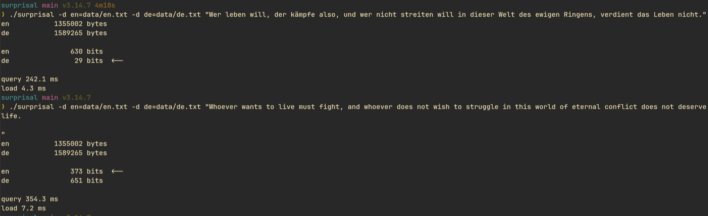

# surprisal
[surprisal](https://en.wikipedia.org/wiki/Surprisal_analysis)

language classifier/id with a hand-rolled lz77 compressor. basically a text classifier - no ml, no training, one c file.

it figures out what language a sentence is by asking: which reference text/data finds this sentence least surprising?

lets take this famous quote from [Mein Kampf](https://en.wikipedia.org/wiki/Mein_Kampf).

> Whoever wants to live must fight, and whoever does not wish to struggle in this world of eternal conflict does not deserve life.



630 bits against 29. the english reference has almost nothing to point at, so the sentence is spelled out byte by byte. the german one has the whole thing, so it's one pointer.

this sentence is from the german reference, so it matches itself. the big gap shows how cheap copying is, not that it understands language. see [results](#results) for held-out text.

## the idea

Compression is Intellegence

[](https://www.youtube.com/watch?v=l6DKRf-fAAM)

i have watched this 3b1b video on information theory several times(the need to understand) and the idea stuck with me.

compression and prediction are the same thing. if you can predict something well, you can write it down in fewer bits. so the number of bits a compressor needs is a measure of how surprised it was.

the information in an event with probability `p` is

```
-log2(p) bits
```

unseen things cost, seen things are cheap. an `e` in english is about 3 bits, a `z` is about 10. i kept thinking of `bias` in neruons while writing this lol

now say a sentence really comes from language `p`, but you compress it with a model of some other language `q`. you pay

```
H(p, q) = H(p) + KL(p || q)
```

the true entropy of the sentence (same no matter which model you use) plus a penalty for believing the wrong thing. so the model with the smallest cost is the one closest to the truth. basically `argmin` 

the "model" here is just a text file.
## how it works

for each class (language) you hand it a reference text. for a query, it computes how many bits it would take to encode the query if it were allowed to point back into that reference. cheapest class wins.

it never writes a compressed file. it only adds up what the file would have cost.

the compressor is greedy lz77:

- at each position, find the longest match earlier in `reference + the part of the query already encoded`
- if the match is worth it, emit a pointer `(distance, length)` and jump ahead
- otherwise emit one raw byte and move by one

matches can run into the query's own text (overlap), so `abababab` is two literals and one pointer.

### the price list

this is the whole model, three lines of arithmetic:

```
raw byte  = 1 flag bit + -log2(p)          p = how common that byte is in the reference
pointer   = 1 flag bit + ceil(log2(pos)) + 7
```

- the flag bit says pointer or literal.
- `ceil(log2(pos))` is the distance field. there are `pos` places a pointer could start, and naming one of `n` things takes `ceil(log2(n))` bits, since `k` bits name `2^k` things.
- 7 bits for the length, so matches cap at 127.
- a match is taken only if it is cheaper than writing those same bytes raw. that's why there's no hardcoded minimum length, short matches just lose on price.

literals priced by frequency is the 3b1b part made literal. the add-one smoothing (`+1`, `+256`) makes sure a byte the reference has never seen costs a big finite number instead of infinity.

umlauts and `ß` are two utf-8 bytes. english almost never has them, so they're nearly free in german and very expensive in english. free signal, no unicode handling.

## build and run

```
gcc -O2 surprisal.c -o surprisal -lm
```

`-lm` links the math library(learning, no use in my tmrw exam tho :( ). `log2` and `ceil` live in libm, and `math.h` only declares them.

### demo

```
./surprisal -d en=data/en.txt -d de=data/de.txt "hi the cat"
```

every `-d` file is a class. the name defaults to the file name if you skip `name=`. any number of classes works. the whole file is used as the reference, input is lowercased.

prints the bit cost per class, an arrow on the winner, and how long the query took.

### test

```
./surprisal -d en=data/en.txt -d de=data/de.txt --test
./surprisal -d en=data/en.txt -d de=data/de.txt --test --split 0.5
```

default is 0.75. sentences are cut on `. ! ?` and only 40 to 160 characters are kept. prints accuracy, a confusion matrix (rows are the true class, columns are the guess), and ms per query.

the reference never sees the test text. if it did, every sentence would match itself and you'd get a fake 100%.

## data

en and de editions of the same book, Mein Kampf by Adolf Hitler, from archive.org, so the only thing that differs between the two references is the language. the files are ocr'd djvu text, so some cleanup was needed: strip the html wrapper, turn the long `ſ` from the fraktur scan into a normal `s`, join hyphenated line breaks. the program expects plain utf-8 text, anything works.


## results

whole books as references (en 1,355,002 bytes, de 1,589,265 bytes).

demo:

```
$ ./surprisal -d en=data/en.txt -d de=data/de.txt "hi the cat"
en                39 bits  <--
de                51 bits

query 72.3 ms
load 7.9 ms
```

test, first 75% of each book as reference, last 25% as queries:

```
$ ./surprisal -d en=data/en.txt -d de=data/de.txt --test
en           1016251 bytes reference, 338751 bytes to test on
de           1191948 bytes reference, 397317 bytes to test on

accuracy: 1891/1891 = 100.0%

true\pred         en      de
en              1004       0
de                 0     887

1891 queries in 243229 ms, 128.62 ms per query
load 8.2 ms
```

100% is easy mode: same book, same style, same ocr noise. the reference never sees the test text, so it's not a leak, but modern text will do worse.

## limits

- **bytes, not characters.** it's not language-aware at all, which is kind of the point.
- **short input is a coin flip.** `hi` has too few chunks to vote with, so costs tie or nearly tie.
- **greedy, no lazy matching.** it takes the longest match right now even if waiting one byte would give a better one.
- **brute force search.** every position compares against every reference position, so time scales with reference size. real zip hashes every 3-byte chunk and keeps a list of where each one appeared, which makes lookup near constant. that's the obvious next thing to add.
- **the price list is made up.** real deflate uses a 32kb window and huffman-codes distance buckets and lengths. ours is a flat estimate. for ranking classes against each other a consistent estimate is enough. also i got my intro to c exam tmrw.
- **lz77 has no counts.** a chunk seen once and one seen 500 times look the same. ppm and context mixing fix that, and neural nets fix it much more.

## where this goes

lz77 plus huffman is DEFLATE. this is the first half, plus a cheap stand-in for the second half (priced literals instead of a real huffman tree). a real ppm or a proper entropy coder would score better, and a transformer would crush it. but it's one file, it runs in a blink, and the score it reports is the same kind of number a language model is trained to minimise.

zip is a bad language model. it still gets the language right.


